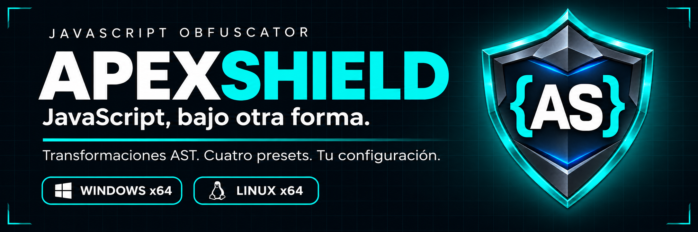

<p align="center">
  
</p>

<p align="center">
  <a href="https://github.com/ZeroCool22/ApexShield/releases/latest"></a>
  
  
  
</p>

<p align="center">
  <a href="#descargas">Descargas</a> ·
  <a href="#funciones">Funciones</a> ·
  <a href="#presets">Presets</a> ·
  <a href="#uso">Uso</a> ·
  <a href="#desarrollo">Desarrollo</a>
</p>

**ApexShield transforma tu JavaScript desde su estructura.** Combiná análisis AST, renombrado de identificadores, ocultación de cadenas y aplanamiento del flujo de control desde una interfaz de escritorio oscura y táctica.

Elegí un preset, ajustá las opciones y exportá el resultado. Disponible para **Windows y Linux x64**.

## Descargas

<table>
  <tr>
    <td align="center" width="50%">
      <h3>🪟 Windows x64</h3>
      <p>Asistente de instalación y accesos directos.</p>
      <a href="https://github.com/ZeroCool22/ApexShield/releases/download/v1.0.0/ApexShield_1.0.0_x64-setup.exe"></a>
      <p><a href="https://github.com/ZeroCool22/ApexShield/releases/download/v1.0.0/ApexShield_1.0.0_windows-x64_portable.zip">ZIP sin instalación</a> · <a href="https://github.com/ZeroCool22/ApexShield/releases/download/v1.0.0/ApexShield_1.0.0_x64_en-US.msi">Paquete MSI</a></p>
    </td>
    <td align="center" width="50%">
      <h3>🐧 Linux x64</h3>
      <p>AppImage o paquete para Debian y Ubuntu.</p>
      <a href="https://github.com/ZeroCool22/ApexShield/releases/download/v1.0.0/ApexShield_1.0.0_amd64.AppImage"></a>
      <p><a href="https://github.com/ZeroCool22/ApexShield/releases/download/v1.0.0/ApexShield_1.0.0_amd64.deb">Paquete DEB para Debian / Ubuntu</a></p>
    </td>
  </tr>
</table>

<p align="center">
  <a href="https://github.com/ZeroCool22/ApexShield/releases/tag/v1.0.0">Ver la versión 1.0.0</a> ·
  <a href="https://github.com/ZeroCool22/ApexShield/releases/download/v1.0.0/SHA256SUMS.txt">Sumas SHA-256</a>
</p>

<details>
<summary><strong>Ver todos los archivos y requisitos</strong></summary>

| Archivo | Uso |
| --- | --- |
| `ApexShield_1.0.0_x64-setup.exe` | Instalador recomendado para Windows x64. |
| `ApexShield_1.0.0_windows-x64_portable.zip` | Extraer y ejecutar `ApexShield.exe` sin instalar la aplicación. |
| `ApexShield_1.0.0_x64_en-US.msi` | Instalador alternativo MSI para Windows. |
| `ApexShield_1.0.0_amd64.AppImage` | Ejecutar en Linux x64 sin una instalación tradicional. |
| `ApexShield_1.0.0_amd64.deb` | Instalar en Debian, Ubuntu y distribuciones compatibles, en arquitectura x64. |
| `SHA256SUMS.txt` | Sumas SHA-256 de las cinco descargas. |

**Windows:** requiere Microsoft Edge WebView2 Runtime. El instalador puede descargarlo si falta; para ejecutar el ZIP sin instalar la aplicación, WebView2 debe estar disponible. [Detalles de WebView2](https://v2.tauri.app/distribute/windows-installer/#webview2-installation-options).

**Linux:** elegí el paquete compatible con tu distribución. Para AppImage, otorgá permiso de ejecución al archivo antes de abrirlo.

Los ejecutables no requieren Node.js ni Rust para usarse.

</details>

## Funciones

<table>
  <tr>
    <td width="33%"><h3>🧬 Motor AST</h3><p>Transformaciones con Babel, análisis de alcance y renombrado de identificadores.</p></td>
    <td width="33%"><h3>🔐 Cadenas ocultas</h3><p>Cifrado RC4, tabla rotada y caché de descifrado en tiempo de ejecución.</p></td>
    <td width="33%"><h3>🔀 Flujo de control</h3><p>Aplanamiento con densidad configurable y omisión de bloques incompatibles.</p></td>
  </tr>
  <tr>
    <td><h3>🎛️ A tu medida</h3><p>Cuatro presets, nombres hexadecimales o confusos y controles independientes.</p></td>
    <td><h3>⚡ Prueba rápida</h3><p>Ejecutor en un Web Worker separado con límite de cinco segundos.</p></td>
    <td><h3>💾 Sesión guardada</h3><p>Autoguardado de entrada, salida y opciones para retomar el trabajo.</p></td>
  </tr>
</table>

También incluye propiedades calculadas, transformaciones de números y booleanos, código muerto, predicados opacos y opciones de anti-formateo, anti-debugging y silenciamiento de consola.

## Presets

| Protocolo | Intensidad | Qué combina |
| --- | :---: | --- |
| 🟢 **Táctico** · `tactical` | Ligera | Renombrado y transformaciones de literales. |
| 🔵 **Blindado** · `armored` | Avanzada | Cadenas ocultas, propiedades calculadas y código muerto. |
| 🟠 **Militar** · `military` | Alta | Aplanamiento de flujo, cadenas, renombrado y opciones de auto-defensa. |
| 🔴 **Chernobyl** · `paranoid` | Máxima densidad | Más transformaciones, nombres confusos y consola silenciada. |

Cada preset es un punto de partida: podés personalizar sus opciones desde la **Matriz de defensa**.

## Uso

| 01 · Cargá | 02 · Configurá | 03 · Ofuscá | 04 · Exportá |
| :--- | :--- | :--- | :--- |
| Pegá tu JavaScript o abrí un archivo. | Elegí el preset y ajustá sus controles. | Presioná **OFUSCAR CÓDIGO**. | Copiá o descargá la salida. |

El editor muestra tiempo de procesamiento, tamaño, expansión y entropía. Incluye ajuste de línea y una prueba rápida de la lógica JavaScript.

<details>
<summary><strong>Compatibilidad del código y del ejecutor de prueba</strong></summary>

ApexShield recibe **JavaScript**. Transpilá TypeScript o JSX antes de ofuscarlo.

El ejecutor de prueba no incluye DOM, `window` ni `document`, y no ejecuta importaciones estáticas de módulos. Los programas que los necesiten se prueban en su entorno real.

</details>

<details>
<summary><strong>Restauración de sesión y recuperación de la interfaz</strong></summary>

ApexShield restaura el último autoguardado completo de entrada, salida y opciones.

En **Windows**, la recuperación nativa supervisa los fallos detectados de WebView2, limita los reintentos y puede activar un modo gráfico de compatibilidad. También podés usar **Interfaz → Recuperar interfaz** o **Ctrl+Shift+R**.

Los detalles y el alcance de la recuperación están en [RECUPERACION.md](RECUPERACION.md).

</details>

## Desarrollo

Construido con **Tauri · Rust · JavaScript · Babel · Vite**.

<details>
<summary><strong>Preparar el entorno y abrir la versión de desarrollo</strong></summary>

Requisitos comunes: **Node.js 24**, **PNPM** y **Rust 1.90 o superior** con Cargo.

- **Windows:** Microsoft C++ Build Tools y WebView2. [Requisitos de Tauri](https://v2.tauri.app/start/prerequisites/#windows).
- **Linux:** dependencias de tu distribución para Tauri y WebKitGTK. [Requisitos de Tauri](https://v2.tauri.app/start/prerequisites/#linux).

Desde la carpeta del proyecto:

```sh
pnpm install --frozen-lockfile
pnpm tauri:dev
```

La aplicación de desarrollo se abre automáticamente. Guardá los cambios de estilo en `src/style.css` para verlos durante el desarrollo.

</details>

<details>
<summary><strong>Compilar el ejecutable y los instaladores</strong></summary>

Ejecutable release sin instaladores:

```sh
pnpm tauri:build --no-bundle
```

Ejecutable e instaladores para el sistema en el que compilás:

```sh
pnpm tauri:build
```

| Sistema | Salida |
| --- | --- |
| Windows | `src-tauri/target/release/ApexShield.exe` |
| Instaladores Windows | `src-tauri/target/release/bundle/nsis/` y `bundle/msi/` |
| Paquetes Linux | `src-tauri/target/release/bundle/appimage/` y `bundle/deb/` |

</details>

<details>
<summary><strong>CLI, pruebas y estructura del proyecto</strong></summary>

Ofuscar desde la terminal:

```sh
pnpm cli -i entrada.js -o salida.obf.js -p armored
pnpm cli -i entrada.js --seed 42 --no-antitamper
pnpm cli --help
```

Ejecutar las pruebas:

```sh
pnpm test
cargo test --manifest-path src-tauri/Cargo.toml --lib
```

La suite incluye **1.600 ejecuciones comparativas** del ofuscador, más pruebas de módulos, Unicode, CLI y restauración de la sesión.

| Carpeta | Contenido |
| --- | --- |
| `src/` | Interfaz, recuperación de sesión y motor de ofuscación. |
| `src/obfuscator/transforms/` | Transformaciones del AST. |
| `src-tauri/` | Aplicación nativa e instaladores. |
| `bin/` | Interfaz de línea de comandos. |
| `test/` | Pruebas automatizadas. |

</details>

---

<p align="center">
  <br />
  <strong>ApexShield</strong> · Desarrollado por <a href="https://github.com/ZeroCool22">ZeroCool22</a><br />
  <sub>JavaScript, bajo otra forma.</sub>
</p>
